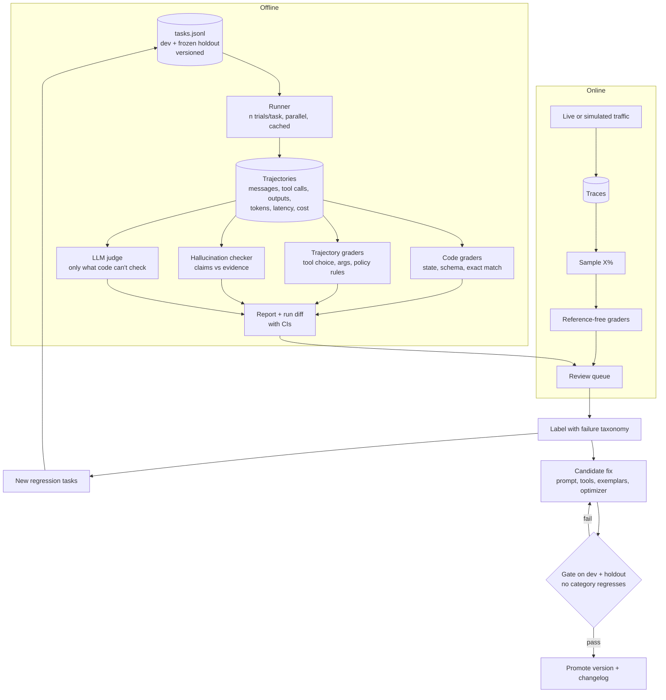

# Architecture

This is the target architecture from the brief. Each box maps to code in this repository.

## Map from box to code

| Box | File |
|---|---|
| Store database, policy, tools | `env/seed.py`, `env/policy.py`, `env/tools.py`, `agent/policy.md` |
| Agent loop (model call, tool calls, tool results, repeat; max 15 steps) | `agent/loop.py` |
| Model calls, cache, retries | `agent/llm.py` |
| Agent versions (prompt, tool descriptions, guardrail, memory) | `agent/versions.py`, `agent/tool_specs.py`, `agent/memory.py` |
| Tasks, dev/holdout split, freeze | `evals/build_tasks.py`, `evals/tasks.jsonl`, `evals/tasks.py`, `evals/holdout.lock` |
| Runner | `evals/runner.py` |
| Code graders | `evals/graders/state.py` |
| Trajectory graders | `evals/graders/trajectory.py`, `evals/graders/policy.py` |
| Hallucination checker | `evals/graders/hallucination.py` (code), `evals/graders/judge.py` (claims) |
| LLM judge | `evals/graders/judge.py`, `evals/graders/judge_prompts.py` |
| Report and run diff | `evals/report.py`, `evals/diff.py`, `evals/noise.py`, `stats/metrics.py` |
| Judge validation | `evals/label.py`, `evals/judge_validation.py` |
| Failure taxonomy, triage | `evals/taxonomy.py`, `evals/triage.py` |
| New regression tasks | `evals/grow.py`, `evals/similarity.py` |
| Gate | `evals/gate.py` |
| Online: simulated user, scoring, dashboard, review queue | `online/simulate.py`, `online/score.py`, `online/dashboard.py`, `labels/review_queue.jsonl` |

## Data flow in one trial

1. The runner picks a task and a trial number. It makes a seed from the task id, the trial number and the run salt.
2. The agent loop builds the system prompt (policy, and examples for v3) and sends the first customer message.
3. The model answers with text or tool calls. The loop runs each tool call in a fresh in-memory SQLite database.
4. A scripted user sends the next message each time the agent ends a turn with text. The trial ends when the script ends, or after 15 model calls.
5. The loop saves every event, the tokens, the latency and the final database change as one JSON line.
6. The graders read the trajectory and the task. They never call the agent.

## Design decisions

- The tools do not enforce policy. The agent must follow the policy, and the code graders check it.
- The expected result of each task is made by running its reference solution in the environment. A test checks that all reference solutions pass all graders (`tests/test_tasks.py`).
- Success uses code graders only (state, answer, policy). The judge adds hallucination and refusal quality as separate metrics.
- Model calls are cached on disk. A repeated call with the same input costs nothing.
